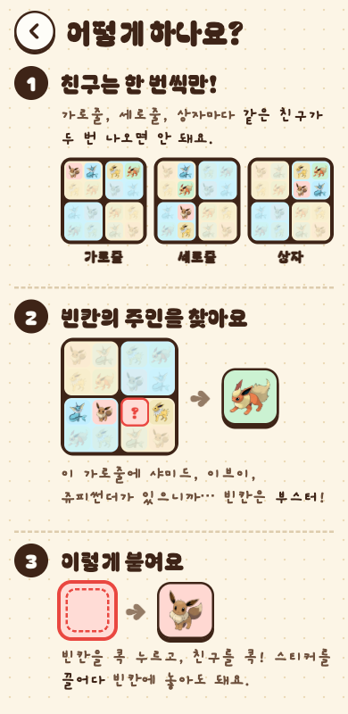
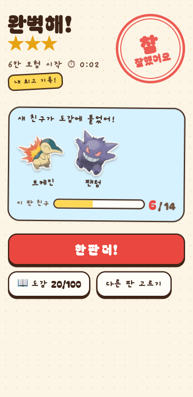
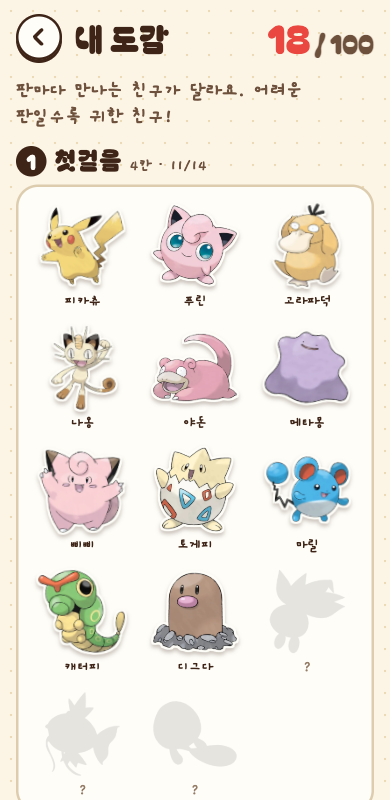
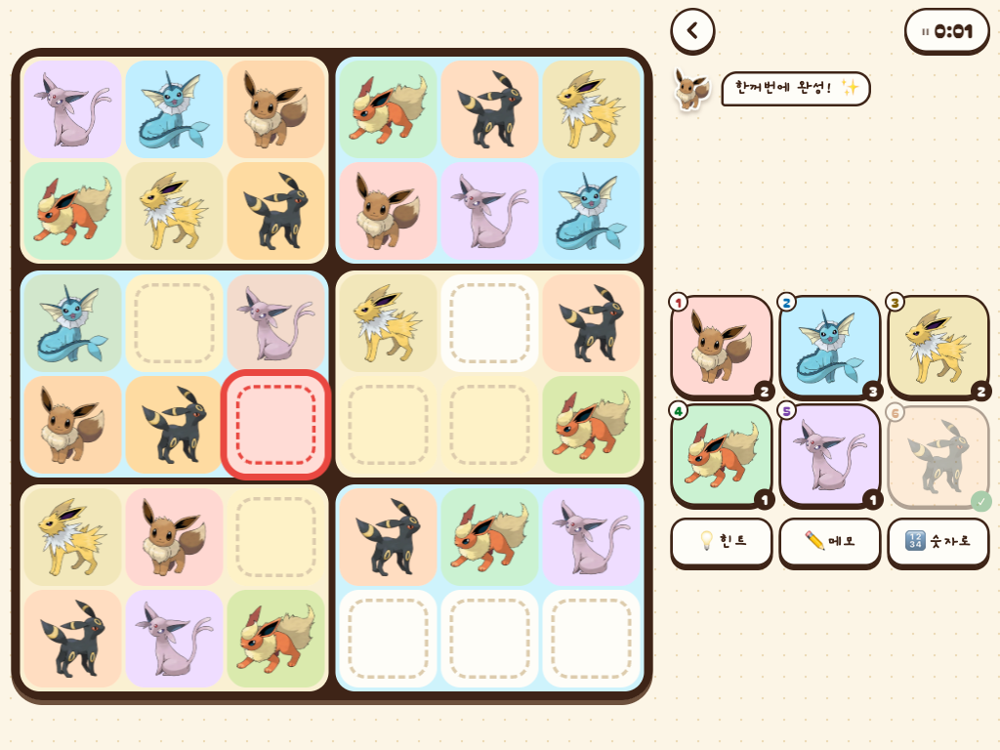

# 포켓몬 스도쿠

포켓몬 스티커를 붙이며 푸는 어린이 스도쿠. 빌드 없이 돌아가는 정적 웹페이지라서 폰·태블릿·PC 브라우저 어디서나 열린다.

**▶ 바로 하기: <https://barolo84.github.io/pkmsudoku/>**

<p>
  
  
  
  
  
</p>


## 노는 방법

목표는 **도감 채우기**다. 판을 완성할 때마다 포켓몬이 도감에 붙고, 100마리를 모두 모으면 끝.

1. **누구랑 할까?** — 판에 붙일 스티커 팀(9마리 × 8팀)을 고른다.
2. **어떤 판으로 할까?** — 난이도를 누르면 바로 시작한다. 버튼에 그 판에서 모은 친구 수(`3/14`)가 보인다.
3. 빈칸을 누르고 스티커를 고르거나, 스티커를 **끌어다** 빈칸에 놓는다. 스티커를 먼저 누르고 빈칸을 눌러도 된다.

- 틀린 스티커는 붙지 않고 돌아간다. 왜 안 되는지("같은 가로줄에 피카츄가 있어!") 알려준다. 게임 오버는 없다.
- **힌트**는 한 판에 쓸 수 있는 수가 정해져 있다 (4칸 2개 · 6칸 3개 · 9칸 5개). 한 번 쓰면 찾기 쉬운 칸이
  반짝이고, 한 번 더 누르면 그 칸에 붙여 준다. 반짝이는 힌트는 그 칸이 채워질 때까지 남는다.
- **메모**(6칸·9칸): 빈칸에 작은 숫자로 후보를 적어 둔다.
- **그림 ↔ 숫자**: 같은 판을 숫자 스도쿠로 바꿔 볼 수 있다.
- **나가기**(←)를 누르면 고른다: *나중에 이어서 하기*(처음 화면에 "이어서 하기"가 남는다) / *그냥 나가기*(그 판은 사라진다).
- **게임 방법**: 처음 화면의 "❓ 어떻게 하나요?"나 게임 중 왼쪽 위 도우미 친구(작은 `?` 표시)를 누르면
  그림으로 된 설명이 열린다. 게임 중에 열면 시계가 멈추고, 닫으면 하던 판으로 돌아온다.
- PC 키보드: 방향키(칸 이동), 숫자키(붙이기), `H` 힌트, `M` 메모, `Space` 잠깐 쉬기.

### 난이도와 도감

난이도마다 **얻을 수 있는 포켓몬이 정해져 있다.** 쉬운 판에는 흔한 친구, 어려운 판일수록 귀한 친구가 나오고,
전설의 포켓몬은 가장 어려운 판에서만 얻는다. 한 판을 완성하면 그 판의 친구가 붙는다 (4칸 1마리, 6칸 2마리, 9칸 3마리).
함께 논 팀에 그 판의 친구가 있으면 그 친구가 먼저 온다.

| Lv | 이름 | 판 | 빈칸 | 힌트 | 만나는 친구 |
| --- | --- | --- | --- | --- | --- |
| 1 | 첫걸음 | 4×4 | 6 | 2 | 어디서나 만나는 친구 14마리 (피카츄, 푸린, 캐터피…) |
| 2 | 한 걸음 더 | 4×4 | 9 | 2 | 작고 귀여운 친구 14마리 (이브이, 피츄, 따라큐…) |
| 3 | 모험 시작 | 6×6 | 14 | 3 | 처음 받는 포켓몬 1~4세대 + 잠만보, 팬텀 — 14마리 |
| 4 | 씩씩한 모험 | 6×6 | 20 | 3 | 처음 받는 포켓몬 5~9세대 — 15마리 |
| 5 | 체육관 도전 | 9×9 | 36 | 5 | 진화한 친구 14마리 (이브이 진화형, 라이츄, 윈디…) |
| 6 | 챔피언 로드 | 9×9 | 45 | 5 | 멋쟁이 포켓몬 14마리 (리자몽, 망나뇽, 루카리오…) |
| 7 | 포켓몬 마스터 | 9×9 | 52 | 5 | 전설의 포켓몬 15마리 (뮤츠, 루기아, 레쿠쟈…) |

모든 판은 답이 하나뿐이고, 찍지 않아도 "이 자리에 올 수 있는 건 하나뿐" 추론만으로 끝까지 풀린다.

### 별

별은 힌트·실수가 없으면 3개, 합쳐서 3번 이하면 2개, 그 밖엔 1개. 난이도마다 가장 많이 받은 별이 처음 화면에 남는다.
도감·별은 모두 그 기기(브라우저)에만 저장된다 — 순위표나 이름 입력은 없다.

**도감 초기화**(부모용 숨은 기능): 도감 화면 제목의 📖를 1.5초 안에 3번 누르면 "처음부터 다시 모을까요?"가 뜬다.
모은 친구와 별이 모두 지워진다.

## 파일

| 파일 | 내용 |
| --- | --- |
| `index.html` / `style.css` | 화면 (스티커북 콘셉트, `.impeccable.md`에 디자인 기준) |
| `app.js` | 화면 동작: 입력, 기기 저장 |
| `engine.js` | 스도쿠 로직: 퍼즐 생성, 풀이, 힌트 (화면과 무관) |
| `records.js` | 걸린 시간, 별, 힌트 상한, 도감 보상 (화면과 무관) |
| `data.js` | 도감 100마리, 난이도별로 얻는 친구, 스티커 팀, 난이도 이름 |
| `images/` | 포켓몬 이미지 100장 (`<도감번호>.webp`) |
| `tests/` | `engine.js`, `records.js`, `data.js` 테스트 |

## 실행 · 테스트

```sh
python3 -m http.server 8000   # http://localhost:8000 (index.html을 그냥 더블클릭해도 된다)
node --test                   # 로직·데이터 테스트 38개
```

파일을 고친 뒤 배포할 때는 `index.html`의 `?v=` 숫자를 올려야 브라우저가 새 파일을 받는다.

## 배포 (GitHub Pages)

pkmq와 같은 방식이다. `main` 브랜치에 push하면 GitHub Pages(`main` 브랜치 `/ (root)`)가 1~2분 안에
<https://barolo84.github.io/pkmsudoku/> 에 반영한다. iPad/iPhone은 공유 → "홈 화면에 추가"로 앱처럼 쓸 수 있다.

## 포켓몬 바꾸기

모두 `data.js`에 있다. 이미지는 `images/<도감번호>.webp`.

- **난이도별로 얻는 친구**: `BY_LEVEL`. 한 포켓몬은 한 난이도에만 넣는다. 여기 적힌 포켓몬 전체가 곧 도감이다.
- **스티커 팀**: `TEAMS`. 팀 안의 순서가 판에 쓰이는 순서라서(4칸은 앞의 4마리, 6칸은 앞의 6마리)
  앞쪽에는 색과 모양이 서로 다른 친구를 둔다. 팀의 친구는 모두 도감에 있어야 한다.
- 힌트 상한과 한 판에 붙는 수는 `records.js`의 `HINTS_BY_SIZE`, `REWARDS_BY_SIZE`.

고친 뒤 `node --test`를 돌리면 겹침·누락·이미지 유무를 잡아 준다.

---

개인·가족용 팬 프로젝트. 포켓몬 캐릭터와 이미지의 권리는 Nintendo / Creatures Inc. / GAME FREAK inc.에 있다.
